<div align="center">



<br/><br/>

[](https://github.com/VarshuDev/tinylink/actions/workflows/ci.yml)
[](#architecture)
[](#project-structure)
[](#highlights)
[](LICENSE)

**Self-hosted edge URL shortener, instant SVG/PNG QR generator, link access controls, and privacy-first analytics running inside a single Cloudflare Worker at $0/month.**

[Quick Deploy](#quick-deploy-60-seconds) · [Personal Setup Guide](PERSONAL_SETUP.md) · [Hosting & API Reference](HOSTING_GUIDE.md)

</div>

---

##  Architecture

<div align="center">
  
</div>

TinyLink serves the **JSON API**, **edge redirects**, **read-only public stats**, **Service Worker shell**, and **OLED Dark / Crisp Light dashboard** from one Cloudflare Worker backed by **Workers KV**—zero servers, zero cold-start penalties, and no external database setup.

---

##  Highlights

| Category | What You Get |
|----------|--------------|
| **Smart Conditional Routing** | Geotargeting (`cf.country`), Device targeting (`ios` / `android` / `desktop` overrides), and Activation Schedule window (`startsAt` / `expiresAt` with `fallbackUrl` or branded `425 Not Active Yet` page) |
| **Outgoing Webhook Stream** | Real-time event webhooks (`link.clicked`, `link.limit_reached`, `link.expired`, `test.ping`) with automated **Discord embeds**, **Slack blocks**, or JSON with HMAC-SHA256 signature (`X-TinyLink-Signature`) |
| **Edge Redirects & Pages** | Sub-5ms `302` redirects globally, trailing-slash normalization, branded `404`, `410` (expired / limit-reached), and `425` (scheduled / pending) pages |
| **Smart Link Controls** | Click caps & **burn-after-read** (`maxClicks`), PBKDF2-HMAC-SHA256 **link passwords**, labels, `#tags` filtering, duplicate URL hints, and a **UTM Campaign Builder** |
| **Rich Telemetry & Bot Shield** | Exact UTC hourly/daily timeline, bounded referrers/countries, device split, **visitor countries** (`cf.country`), and preview-bot filtering so Slack/WhatsApp unfurls never burn `maxClicks` |
| **Social Cards & Public Stats** | Custom `og:title` & `og:description` preview metadata for unfurlers plus opt-in shareable `/stats/:slug` pages (masks locked destinations automatically) |
| **QR Code Studio** | Crisp high-contrast sanitized SVG QR per link with 1-click **SVG** & **512px PNG** downloads |
| **Zero-Friction Capture & PWA** | `/sw.js` Service Worker, `?url=` / `?text=` prefill with origin confirmation toast, Android **PWA Share Target**, bookmarklet, Chrome `tl` omnibox shortcut, PowerShell helper |
| **Vault Auth & Hardening** | Fail-closed `ADMIN_TOKEN` guard, signed `HttpOnly; SameSite=Strict` session cookies, same-origin CORS/CSRF enforcement, strict non-inline CSP, KV IP rate limiting (`429` + `Retry-After` on admin & password unlocks), full IPv4/IPv6 SSRF protection |
| **Bulk Ops & Backups** | Multi-select bulk delete (`/api/bulk-delete`), CSV export, full **JSON backup export & import** (`skip`/`overwrite`), cursor-paginated KV listing (`>1,000` keys) |

---

##  Quick Deploy (60 Seconds)

### 1. Clone & Install

```bash
git clone https://github.com/VarshuDev/tinylink.git
cd tinylink
npm install
```

### 2. Create Your KV Namespace

```bash
npx wrangler kv namespace create URL_KV
```

Copy `wrangler.example.toml` to `wrangler.toml` (`wrangler.toml` is gitignored so your personal KV ID stays private) and paste your namespace ID:

```bash
cp wrangler.example.toml wrangler.toml
```

```toml
[[kv_namespaces]]
binding = "URL_KV"
id = "your-kv-namespace-id"
```

### 3. Set Your Admin Token

```bash
npx wrangler secret put ADMIN_TOKEN
```

> TinyLink **fails closed** (`503`) unless `ADMIN_TOKEN` is configured (set a 16+ character random secret in production). Query-string admin auth (`?token=`) and `localStorage` token persistence are disabled; browser logins mint signed `HttpOnly; SameSite=Strict` session cookies under `/api/auth/*`, while scripts use `X-Auth-Token` or `Authorization: Bearer`. For unauthenticated local sandboxes only, set `ALLOW_PUBLIC_ADMIN = "true"` in `wrangler.toml`.

### 4. Type Check, Test & Deploy

```bash
npm run check
npm test
npx wrangler deploy
```

Your shortener goes live immediately at `https://url-shortener.<your-subdomain>.workers.dev` (or connect any custom domain like `go.yourdomain.com` for free under **Workers & Pages → Custom Domains**).

---

##  Project Structure

```
url-shortener/
├── .github/workflows/
│   └── ci.yml                # GitHub Actions: tsc --noEmit & Vitest on push/PR
├── docs/
│   ├── hero.svg              # Animated README banner
│   ├── architecture.svg      # Animated edge redirect & telemetry diagram
│   └── icons/                # Vector section icons (SVG)
├── src/
│   ├── index.ts              # Router, vault auth, rate limiter, KV storage, redirect & API handlers
│   ├── frontend.ts           # Server-rendered OLED Dark/Light console, UTM/QR studio & bulk tools
│   ├── pages.ts              # Status pages (404/410/425), password gate, OG preview card & /stats/:slug
│   ├── types.ts              # Shared TypeScript interfaces for KV records, API payloads & env
│   └── qrcode.d.ts           # QRCode module TypeScript declarations
├── test/
│   └── worker.test.ts        # Offline Vitest Worker integration & HTML inline script suite
├── wrangler.example.toml     # Safe Worker & KV binding template (copy to wrangler.toml)
├── tsconfig.json             # Strict TypeScript config
├── package.json              # Scripts: dev, deploy, tail, check, test
├── LICENSE                   # MIT License
├── HOSTING_GUIDE.md          # Complete deployment, quotas & curl reference
└── PERSONAL_SETUP.md         # Bookmarklet, Chrome 'tl' omnibox, PowerShell & mobile PWA guide
```

---

##  API Reference

Protected routes accept `X-Auth-Token: <token>` or `Authorization: Bearer <token>`.

| Method | Endpoint | Auth | Description |
|--------|----------|:----:|-------------|
| `GET` | `/api/health` | No | Lightweight health & auth status check |
| `POST` | `/api/shorten` | Yes | Create link (`url`, `custom`, `expiresIn`, `label`, `tags`, `maxClicks`, `password`, `ogTitle`, `ogDescription`, `publicStats`, `dedupe`) |
| `GET` | `/api/list` | Yes | Cursor-paginated list of all links (`>1,000` KV keys + KV metadata fallback supported) |
| `GET` | `/api/analytics/:slug` | Yes | Timeline, devices, referrers, countries, `botClicks` & SVG QR code |
| `PUT` | `/api/urls/:slug` | Yes | Update URL, expiry, label, tags, click limit, password (`password` / `clearPassword`), OG tags & `publicStats` |
| `DELETE` | `/api/urls/:slug` | Yes | Permanently delete link and telemetry |
| `POST` | `/api/bulk-delete` | Yes | Delete up to `45` slugs per request |
| `POST` | `/api/import` | Yes | Import up to `20` links per batch (`mode`: `"skip"` or `"overwrite"`) |
| `GET` | `/stats/:slug` | Opt-in | Public read-only analytics view when `publicStats: true` |
| `GET` / `POST` | `/:slug` | No | Edge redirect (`302`), OG unfurl preview, password unlock (`200`/`401`/`303`), expired/exhausted (`410`), or missing (`404`) |
| `GET` | `/sw.js` | No | Offline PWA shell Service Worker |

<details>
<summary><strong>Expand curl request & response examples</strong></summary>

```bash
BASE="https://url-shortener.your-subdomain.workers.dev"
TOKEN="<YOUR_ADMIN_TOKEN>"

# Create a tagged, single-use (burn-after-read) link with custom OG metadata & public stats
curl -X POST "$BASE/api/shorten" \
  -H "Content-Type: application/json" \
  -H "X-Auth-Token: $TOKEN" \
  -d '{
    "url": "https://github.com/cloudflare/workers-sdk",
    "custom": "workers",
    "expiresIn": "30",
    "label": "Workers SDK",
    "tags": ["cloudflare", "docs"],
    "maxClicks": 50,
    "publicStats": true
  }'

# Update destination, clear expiration ("never"), or remove password
curl -X PUT "$BASE/api/urls/workers" \
  -H "Content-Type: application/json" \
  -H "X-Auth-Token: $TOKEN" \
  -d '{"url": "https://developers.cloudflare.com/workers/", "expiresIn": "never", "clearPassword": true}'

# Bulk delete multiple slugs
curl -X POST "$BASE/api/bulk-delete" \
  -H "Content-Type: application/json" \
  -H "X-Auth-Token: $TOKEN" \
  -d '{"slugs": ["old-promo", "temp-link"]}'
```

</details>

---

##  Development & Security Checklist

- Run `npm run check && npm test` before deploying to verify strict TypeScript types, KV metadata bounds, SSRF/CSRF/auth hardening, rate limits, and non-inline CSP scripts.
- Keep `wrangler.toml`, `.dev.vars`, and `.wrangler/` out of version control (all excluded via [`.gitignore`](.gitignore)).
- Use [`PERSONAL_SETUP.md`](PERSONAL_SETUP.md) to configure Android PWA Share Sheet, browser bookmarklets, Chrome omnibox search, and Windows PowerShell helpers.

---

##  License

Distributed under the [MIT License](LICENSE).
